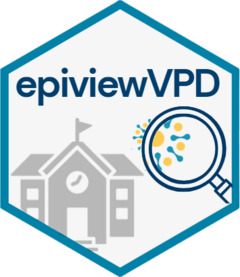

# epiviewVPD 

epiviewVPD is an R package for mapping surveillance data and school vaccination
coverage data for vaccine preventable diseases (VPDs), with an option to
implement features in an interactive dashboard. It was developed by the
[Midwest Analytics and Disease Modeling Center
(MADMC)](https://www.sph.umn.edu/research/centers/midwest-analytics-and-disease-modeling/)
at the University of Minnesota School of Public Health. The package is based on
[Midwest EpiView: MMR Coverage and Measles](http://z.umn.edu/mmr-measles) and
Midwest EpiView: Chickenpox, which are dashboards displaying Minnesota
vaccination coverage and surveillance data that were designed in collaboration
with the Minnesota Department of Health.

This README provides a brief overview of how to use the package and what is
included in the repository. For additional details, review the separate guides
linked below:

- **[Getting started](guides/1-get-started.md):** install epiviewVPD and the R
  packages needed to run it.
- **[Data Format](guides/2-data-format.md):** prepare/format your data for use
  in epiviewVPD.
- **[Interactive Dashboard](guides/3-own-data.md):** make a project folder, add
  your files, set your state, and run the dashboard code.
- **[Visualizations Without the Interactive
  Dashboard](guides/4-visualizations.md):** build each map, chart, and table
  and save as standalone files, separate from the dashboard.
- **[Additional Features](guides/5-adding-more.md):** extend the dashboard and
  visualizations with child cares, grade-level coverage, school districts and
  other available data layers.


**On this page:** [What's in the interactive
dashboard](#whats-in-the-interactive-dashboard) | [Installation](#installation)
| [Use your own data](#use-your-own-data) | [Visualizations without the
interactive dashboard](#visualizations-without-the-interactive-dashboard) |
[What's in this repository](#whats-in-this-repository) | [Questions or
problems?](#questions-or-problems)

## What's in the interactive dashboard

epiviewVPD starts with a **core dashboard** that has three tabs: About,
Dashboard, and Summary Figures. Users have the option to add two more tabs:
Proximity Map and Resources. Features of each tab are outlined below:

| Dashboard Tab | What it displays |
|---|---|
| **About** | An explanation of what the dashboard shows, definitions, and notes about the data. Users have the option to write specific text for this page in the settings file. |
| **Dashboard** | A state-level map of vaccination coverage and historical cases by county, with filters for year. Users can select a county to zoom in and view the schools within that county. |
| **Summary Figures** | A table of school vaccination coverage for a selected county with a figure and table displaying historical cases by year and age group. Users can download vaccination and case data summaries as standalone reports. |
| **Proximity Map (Optional)** | A geospatial search tool that can be used to look up a school or address to identify nearby facilities with lower vaccination coverage. Results are displayed on a map and in a table, and can be downloaded as a PDF, CSV, or Excel file. |
| **Resources (Optional)** | A tab with resources for using the dashboard including FAQs and links to public health resources. |

It is recommended that users start by getting the core dashboard working before
adding in the other tabs or additional data. See [Adding
more](guides/5-adding-more.md).

## Package Overview

### Installation

epiviewVPD needs **R version 4.5 or newer** and may not install on older
versions of R. RStudio is recommended because it includes Pandoc, which is
required to download reports from the dashboard. The [Getting
started](guides/1-get-started.md) guide includes additional information on
these steps and fixes for common install errors.

**1. Install epiviewVPD.** In the R Console, run:

```r
install.packages("remotes")
remotes::install_github("MADM-C/epiviewVPD", upgrade = "never")
```

Running this code installs the epiviewVPD package and all additional R packages
needed for epiviewVPD to run. The first install can take several minutes if
none of the required R packages have been previously installed.

**2. Try the artificial data.** Artificial data is included in the epiviewVPD
package and can be used to test various package functions. All of the
artificial data is randomly generated, including the state and county
boundaries.

```r
library(epiviewVPD)
run_dashboard(data_dir = example_data_dir())
```

The dashboard opens in a new window. To close it, click the red **Stop** button
in the Console (or press **Esc** there).

An internet connection is required to install the package, to draw the
background map, and to download your state's county boundaries the first time
you run the dashboard.

### Use your own data

This is a brief overview of how to format your own data to use in epiviewVPD.
The [Dashboard](guides/3-own-data.md) guide provides additional details and
instructions, including how to practice first with the artificial data files.

Begin by creating a new RStudio project (**File > New Project**). Within the
project folder, create a folder named `app_data`. Save three separate CSV files
described in the table below in the `app_data` folder, and make sure the file
and column names match the [data format guide](guides/2-data-format.md)
exactly. When formatting files, ensure that each row follows the following
format in the table below:

| File Name | Each Row Represents: | Required Columns |
|---|---|---|
| `counties.csv` | One County | `county_fips` or `county_name`, `enroll`, `full_vax_pct` |
| `schools.csv` | One School | `school_id`, `school_name`, `latitude`, `longitude`, `enroll`, `full_vax_pct` |
| `cases.csv` | One County, stratified by year | `county_fips` or `county_name`, `year`, `n_cases` |

In the R Console, load the package, then copy and open the settings file:

```r
library(epiviewVPD)
file.copy(system.file("config", "template.R", package = "epiviewVPD"), "my_settings.R")
file.edit("my_settings.R")
```

In `my_settings.R` file, find the `geography` line (approximately line 109).
Update it with your state's two-letter code and save the file:

```r
# In my_settings.R (not the Console):
geography = list(state = "WI", district_type = "unified"),
```

Then run the following code to start the core dashboard:

```r
run_dashboard(data_dir = "app_data", config = "my_settings.R")
```

### Visualizations without the interactive dashboard

For users who are not interested in an interactive dashboard, each map, chart,
and table can be built in R and saved as a standalone file outside of the
dashboard.

```r
library(epiviewVPD)
data <- load_app_data(example_data_dir())

build_coverage_map(data$counties)
plot_epicurve(data$cases, counties = data$counties)
```

See [Maps and charts without the dashboard](guides/4-visualizations.md) for the
full list of visualization functions and for instructions on how to use your
own data.

## What's in this repository

```
epiviewVPD/
├── DESCRIPTION              Package metadata and dependencies
├── NAMESPACE                Functions exported by the package, generated by roxygen2
├── LICENSE, LICENSE.md       MIT license
├── README.md                 Package overview and instructions
├── app.R                     Runs the dashboard from the repository for development
├── epiviewVPD.Rproj          RStudio project file for package development
├── R/                        Package source code
│   ├── run_dashboard.R           Reads settings and data and starts the dashboard
│   ├── load_app_data.R           Reads and checks the data files
│   ├── input_validation.R        Validates values in each data file
│   ├── dashboard_settings.R      Default settings and feature switches
│   ├── app_ui.R                  Dashboard layout, including tabs, sidebars, and maps
│   ├── app_server.R              Connects dashboard inputs to outputs
│   ├── standalone_maps.R         Functions for building maps
│   ├── standalone_tables.R       Functions for building tables
│   ├── table_measles_functions.R Functions for case tables and charts
│   ├── save_visualizations.R     Functions for saving maps, figures, and tables
│   └── ...                       Additional files for dashboard sections and features
├── inst/
│   ├── config/
│   │   ├── template.R            Settings template for use with your data
│   │   └── measles_mn.R          Minnesota settings with all features enabled
│   ├── extdata/
│   │   ├── example-basic/        Artificial data for the basic dashboard
│   │   └── example/              Artificial data for all features
│   ├── reports/                  Templates for downloadable reports
│   └── app/www/                  Logo and case study PDFs shown in the dashboard
├── man/                      Generated help pages; man/figures contains screenshots
├── tests/testthat/           Automated tests
└── guides/                   Guides linked at the top of this README
    ├── 1-get-started.md          Installation and artificial-data example
    ├── 2-data-format.md          Data files and column requirements
    ├── 3-own-data.md             Running the dashboard with your data
    ├── 4-visualizations.md       Maps and charts without the dashboard
    └── 5-adding-more.md          Optional dashboard features
```

## Questions or problems?

- **Found a bug or something unclear?** Open an issue on [GitHub
  Issues](https://github.com/MADM-C/epiviewVPD/issues). Include the code you
  ran, the full error message, and the output of `R.version.string` and
  `packageVersion("epiviewVPD")`. Please don't attach real data; use the
  pre-provided artificial data or a few made-up rows that show the problem.
- **Email:** Alternatively, you can email our team at
  [madmc@umn.edu](mailto:madmc@umn.edu)

## License

MIT; see [LICENSE.md](LICENSE.md).
