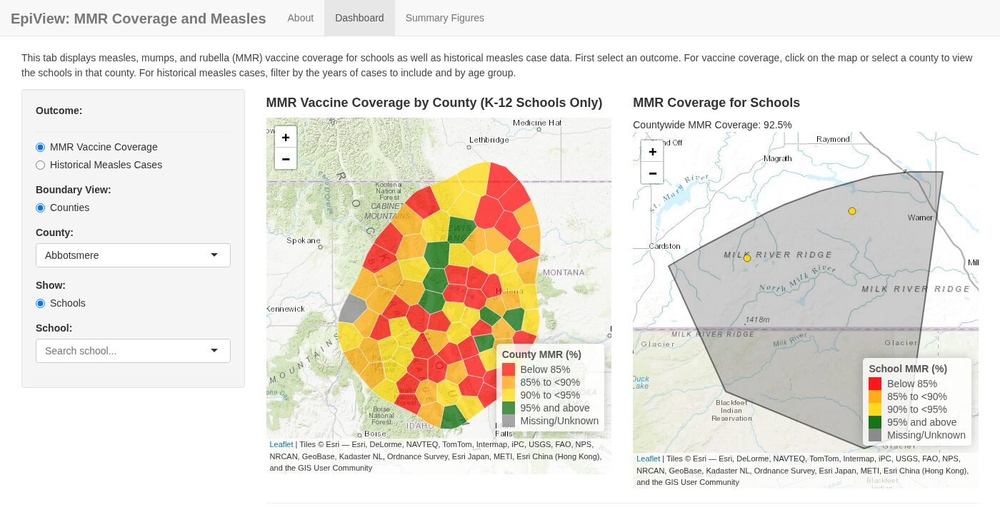

# epiviewVPD

MADM-C's epiviewVPD package provides a framework for users to create their own
version of the [Midwest EpiView: MMR Coverage and Measles Dashboard](http://z.umn.edu/mmr-measles) with their
own MMR and measles data.

epiviewVPD was developed by the [Midwest Analytics and Disease Modeling Center (MADMC)](https://www.sph.umn.edu/research/centers/midwest-analytics-and-disease-modeling/)
at the University of Minnesota School of Public Health. It is built in **R**
using the **Shiny** framework and integrates vaccination, geographic, and
historical case data into a set of interactive maps and tables to support
exploratory public health analysis and outreach. It also includes functions
to make specific visualizations separate from the RShiny/dashboard framework.

The dashboard runs on your own computer, so your data stays there.

This README is a short overview. The guides have each step in detail. Work
through them in order, or jump to the one you need:

1. **[Get started](guides/1-get-started.md):** install R, RStudio, and
   epiviewVPD, then open the dashboard with made-up example data.
2. **[Set up your data](guides/2-data-format.md):** what goes in each file
   and column, and what to do with missing or withheld values.
3. **[Run the dashboard with your data](guides/3-own-data.md):** make a
   project folder, add your files, set your state, and start the dashboard.
4. **[Maps and charts without the dashboard](guides/4-visualizations.md)**
   (optional): build each map, chart, and table in R and save it as a file.
5. **[Adding more](guides/5-adding-more.md)** (optional): child cares,
   grade-level coverage, school districts, and more.



**On this page:** [What's in the dashboard](#whats-in-the-dashboard) |
[Install](#install) |
[Use your own data](#use-your-own-data) |
[Maps and charts without the dashboard](#maps-and-charts-without-the-dashboard) |
[What's in this repository](#whats-in-this-repository) |
[Questions or problems?](#questions-or-problems)

## What's in the dashboard

epiviewVPD starts with the **basic dashboard**, which needs only three data
files: counties, schools, and cases.

| Tab | What it shows |
|---|---|
| **About** | What the dashboard shows, definitions, and notes about the data. You write this text in your settings file. |
| **Dashboard** | A county map of vaccination coverage, or a map of historical cases filtered by year and age group. Pick a county to see its schools on a map, colored by coverage. |
| **Summary Figures** | A table of school coverage for one county, and a chart and table of cases by year and age group. Each one downloads as a report. |

Child cares, grade-level coverage, school details, school districts, a
**Proximity Map** tab, and a **Resources** tab can be turned on once the basic
dashboard works. See [Adding more](guides/5-adding-more.md).

## Install

New to R? The [Get started](guides/1-get-started.md) guide walks through each
step.

**1. Install R.** Download it from <https://cran.r-project.org>. epiviewVPD
needs **R 4.5 or newer** and won't install on older versions.

**2. Install RStudio Desktop** (recommended) from
<https://posit.co/download/rstudio-desktop/>. Downloading reports from the
dashboard needs Pandoc, which RStudio includes.

**3. Install epiviewVPD.** In the RStudio Console, run:

```r
install.packages("pak")
pak::pak("MADM-C/epiviewVPD")
```

This also installs the other R packages epiviewVPD needs, so the first install
can take several minutes.

**4. Try the example data.** All of it is made up, including the state and
county boundaries.

```r
library(epiviewVPD)
run_dashboard(data_dir = example_data_dir())
```

The dashboard opens in a new window. To stop it, click the red **Stop** button
in the Console (or press **Esc** there).

You need an internet connection to install the package, to draw the background
map, and to download your state's county boundaries the first time.

## Use your own data

These are the steps in short. The
[Run the dashboard with your data](guides/3-own-data.md) guide has each one
in detail, including how to practice first with the made-up example files.

Work in an RStudio project (**File > New Project**), so R finds your files.
Save these three CSV files in a folder named `app_data` in the project. File
names and column names must match exactly. The [data format guide](guides/2-data-format.md)
explains every column and has a troubleshooting table.

| File | One row per | Required columns |
|---|---|---|
| `counties.csv` | County | `county_fips` or `county_name`, `enroll`, `full_vax_pct` |
| `schools.csv` | School | `school_id`, `school_name`, `latitude`, `longitude`, `enroll`, `full_vax_pct` |
| `cases.csv` | County, year, and age group | `county_fips` or `county_name`, `year`, `n_cases` |

Copy the settings file and open it:

```r
library(epiviewVPD)
file.copy(system.file("config", "template.R", package = "epiviewVPD"), "my_settings.R")
file.edit("my_settings.R")
```

In `my_settings.R`, find the `geography` line, put your state's two-letter
code in it, and save the file:

```r
# In my_settings.R (not the Console):
geography = list(state = "WI", district_type = "unified"),
```

Then start the dashboard:

```r
run_dashboard(data_dir = "app_data", config = "my_settings.R")
```

## Maps and charts without the dashboard

Each map, chart, and table can be built in R without opening the dashboard,
and saved as a file:

```r
library(epiviewVPD)
data <- load_app_data(example_data_dir())

build_coverage_map(data$counties)
plot_epicurve(data$cases, counties = data$counties)
```

See [Maps and charts without the dashboard](guides/4-visualizations.md) for
the full list and how to use your own data.

## What's in this repository

```
epiviewVPD/
├── DESCRIPTION              Package information and the packages it needs
├── NAMESPACE                Functions the package makes available (made by roxygen2)
├── LICENSE, LICENSE.md      MIT license
├── README.md                This file
├── app.R                    Starts the dashboard from this folder without installing (for development)
├── epiviewVPD.Rproj         RStudio project file for working on the package
├── R/                       Package code
│   ├── run_dashboard.R          run_dashboard(): reads settings and data, starts the dashboard
│   ├── load_app_data.R          load_app_data(): reads and checks the data files
│   ├── input_validation.R       Checks on each data file's values
│   ├── dashboard_settings.R     Default settings and the feature switches
│   ├── app_ui.R                 Dashboard layout (tabs, sidebars, maps)
│   ├── app_server.R             Connects the dashboard's inputs to its outputs
│   ├── standalone_maps.R        Map functions (build_coverage_map(), build_cases_map(), ...)
│   ├── standalone_tables.R      Table functions (build_coverage_table(), ...)
│   ├── table_measles_functions.R  Case tables and charts (plot_epicurve(), render_cases_gt())
│   ├── save_visualizations.R    save_map(), save_figure(), save_table()
│   └── ...                      One file per dashboard section (maps, tables, proximity, grade details)
├── inst/
│   ├── config/
│   │   ├── template.R           Settings file to copy and edit for your data
│   │   └── measles_mn.R         Minnesota's settings, with every feature turned on
│   ├── extdata/
│   │   ├── example-basic/       Made-up data for the basic dashboard
│   │   └── example/             Made-up data for every feature
│   ├── reports/                 Report templates used by the download buttons
│   └── app/www/                 Logo and case study PDFs shown in the dashboard
├── man/                     Help pages (made by roxygen2); man/figures has screenshots
├── tests/testthat/          Automated tests
└── guides/                  Guides, linked at the top of this file
    ├── 1-get-started.md         Install and try the example
    ├── 2-data-format.md         Every data file and column
    ├── 3-own-data.md            Run the dashboard with your data
    ├── 4-visualizations.md      Maps and charts without the dashboard
    └── 5-adding-more.md         Optional features
```

## Questions or problems?

- **Found a bug or something unclear?** Open an issue on
  [GitHub Issues](https://github.com/MADM-C/epiviewVPD/issues). Include the
  code you ran, the full error message, and the output of `R.version.string`
  and `packageVersion("epiviewVPD")`. Please don't attach real data; use the
  example data or a few made-up rows that show the problem.
- **Email:** [madmc@umn.edu](mailto:madmc@umn.edu)

## License

MIT; see [LICENSE.md](LICENSE.md).
