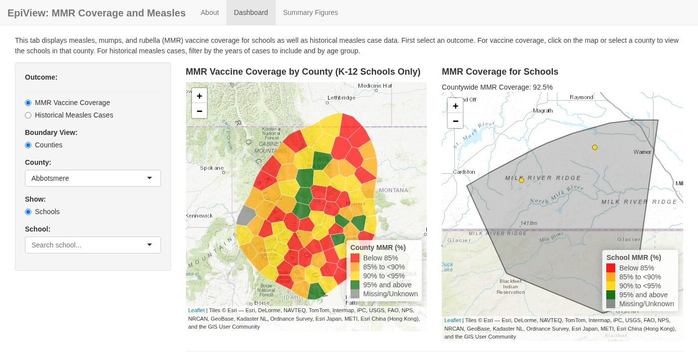
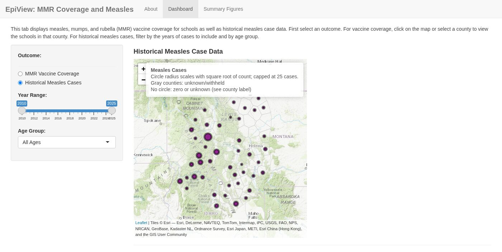
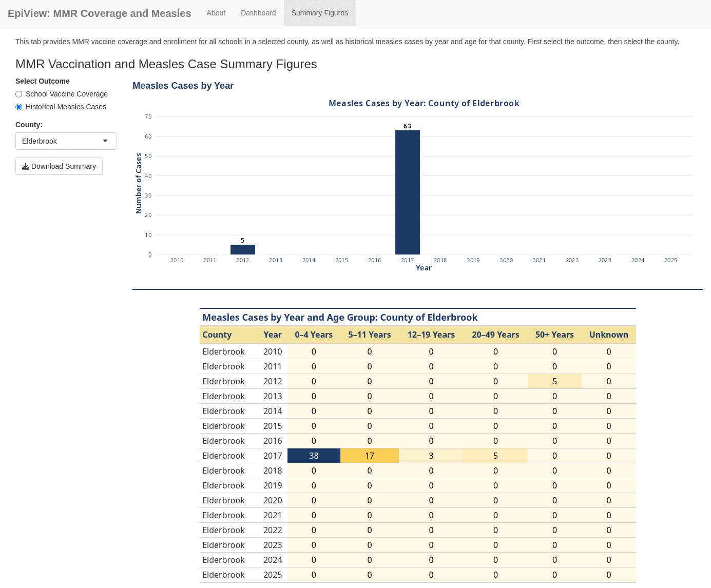
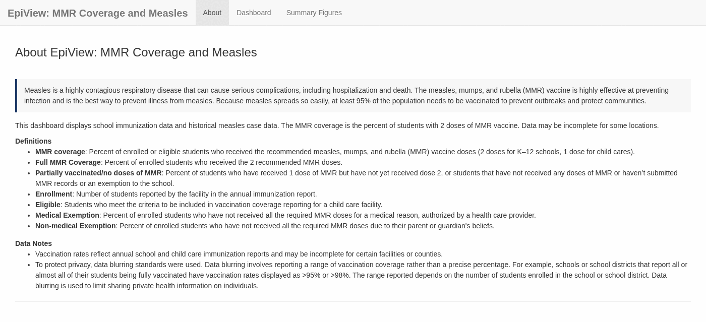

# Get started

This guide takes you from a computer without R to the dashboard running with
the made-up example data. When it works, go on to
[Run the dashboard with your data](3-own-data.md).

## Step 1: Install R

R is the program that runs epiviewVPD. Download it from
<https://cran.r-project.org>.

- **Windows:** click **Download R for Windows**, then **base**, then the
  download link at the top of the page. Run the installer and accept the
  defaults.
- **Mac:** click **Download R for macOS**, then the `.pkg` file for your
  computer. To check which one you need, open the Apple menu and choose
  **About This Mac**. If it lists an **Apple M** chip, use the `arm64` file;
  if it lists an **Intel** processor, use the `x86_64` file.

epiviewVPD needs R **4.5 or newer** and won't install on older versions. If
you already have R, run `R.version.string` in the Console to see your version,
and install the new one if it's older.

## Step 2: Install RStudio

RStudio is a free program that makes R easier to use. Download **RStudio
Desktop** from <https://posit.co/download/rstudio-desktop/>, run the
installer, and accept the defaults.

Open RStudio. The **Console** is the panel at the bottom left with a `>`
prompt. You run each line of code in this guide by pasting it there and
pressing **Enter**.

## Step 3: Install epiviewVPD

Run these two lines in the Console:

```r
install.packages("pak")
pak::pak("MADM-C/epiviewVPD")
```

The first line installs pak, a tool for installing R packages. The second
installs epiviewVPD and the other packages it needs. The first time can take
several minutes. If it asks `Do you want to continue (Y/n)`, type `Y` and
press Enter.

You only need to do this once. To get a newer version of epiviewVPD later, run
`pak::pak("MADM-C/epiviewVPD")` again.

### If the install fails

| What you see | What to do |
|---|---|
| A package "is loaded in the current R session and has locked files in your library", followed by `What do you want to do?` | Type `1` (have pak unload them) and press Enter. |
| A package "is loaded in other R sessions", followed by `What do you want to do?` | Another R or RStudio window is open. Type `4` to stop, close the other window, then run `pak::pak("MADM-C/epiviewVPD")` again. |
| `Needs R >= 4.5.0`, or `Can't install dependency` | R is too old. Check `R.version.string` and install a current version ([step 1](#step-1-install-r)). |
| `there is no package called 'pak'` | Run `install.packages("pak")` first. |

If none of these fit, see [Questions or problems?](#questions-or-problems).

## Step 4: Try the example

```r
library(epiviewVPD)
run_dashboard(data_dir = example_data_dir())
```

The dashboard opens in a new window. Everything in the example is made up,
including the state and county boundaries. You need an internet connection
for the background map.

To stop the dashboard, close its window, then click the red **Stop** button in
the Console (or press **Esc** there). The `>` prompt comes back when it has
stopped.

## A tour of the dashboard

The example shows the **basic dashboard**, which needs only three data files.

**Dashboard tab.** Choose an outcome on the left. **Vaccine coverage** colors
each county by coverage. Click a county, or pick one from the list, to see its
schools on the map to the right. Hover over a school for its name and
coverage.



**Historical cases** shows the number of cases in each county as a circle.
Use the slider to choose the years and the list to choose an age group.



**Summary Figures tab.** Choose an outcome and a county. **School vaccine
coverage** lists the county's schools with their coverage and enrollment.
**Historical cases** shows a chart and a table of cases by year and age group.
**Download Summary** saves what you see as a report.



**About tab.** What the dashboard shows, definitions, and notes about the
data. You write this text in your settings file.



To see every optional feature with the example data, see
[See everything turned on](5-adding-more.md#see-everything-turned-on).

## Next steps

1. [Set up your data](2-data-format.md): what goes in each file.
2. [Run the dashboard with your data](3-own-data.md).
3. [Maps and charts without the dashboard](4-visualizations.md).
4. [Adding more](5-adding-more.md): child cares, grade-level coverage, school
   districts, and more.

## Questions or problems?

Open an issue on [GitHub Issues](https://github.com/MADM-C/epiviewVPD/issues)
with the code you ran, the full error message, and the output of
`R.version.string` and `packageVersion("epiviewVPD")`. Please don't attach
real data. You can also email [madmc@umn.edu](mailto:madmc@umn.edu).
